<p align="center">
  
</p>

<h1 align="center">Tidy</h1>

<p align="center">
  <strong>A minimalist, privacy-first file manager for macOS.</strong><br />
  Less time managing files, less clutter, find anything instantly.
</p>

<p align="center">
  <a href="https://github.com/shrey/tidy/releases/latest">
    
  </a>
  <a href="#screenshots">
    
  </a>
</p>

<p align="center">
  
  
  
  
  
  
  
</p>

<p align="center">
  <a href="#download--install">Download</a> ·
  <a href="#screenshots">Screenshots</a> ·
  <a href="#features">Features</a> ·
  <a href="#safety--privacy">Privacy</a> ·
  <a href="#build-from-source">Build from source</a> ·
  <a href="#contributing">Contributing</a>
</p>

---

## Watch the launch film

<p align="center">
  <a href="media/tidy-launch.mp4">
    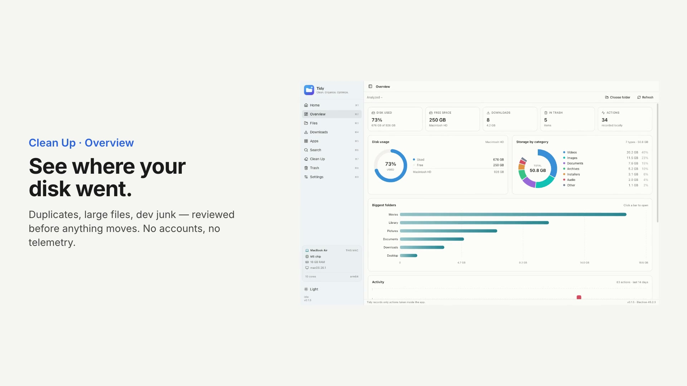
  </a>
</p>

<p align="center">
  <a href="media/tidy-launch.mp4"><strong>▶ Play the film</strong></a> ·
  <a href="media/tidy-launch.mp4" download>Download MP4</a>
</p>

## Screenshots

<p align="center">
  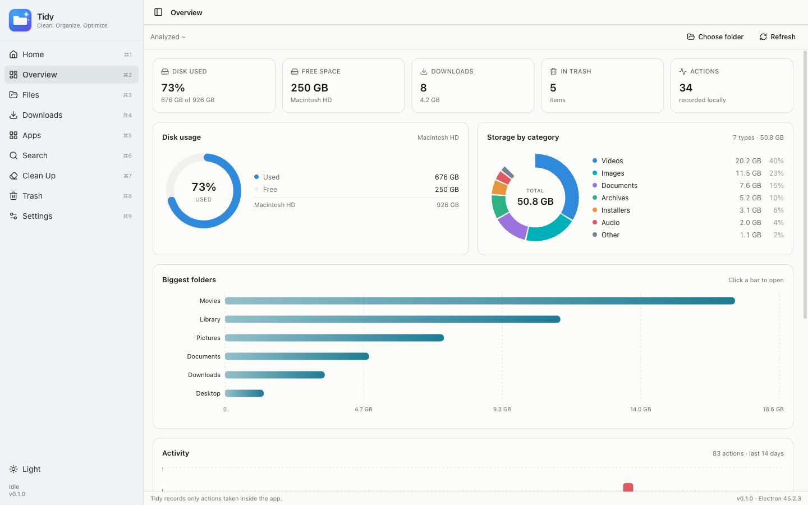
</p>

<table>
  <tr>
    <td width="50%">
      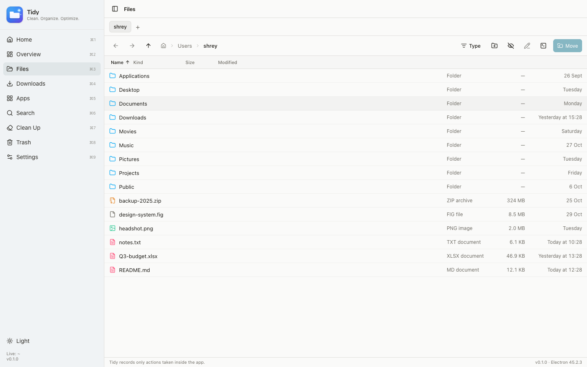
    </td>
    <td width="50%">
      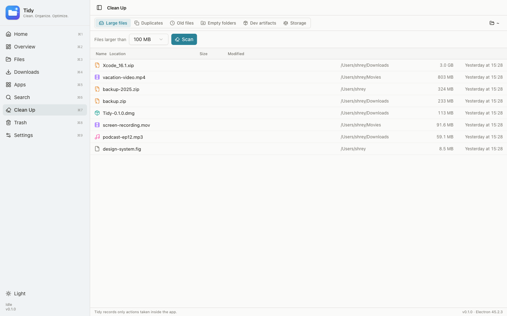
    </td>
  </tr>
  <tr>
    <td width="50%">
      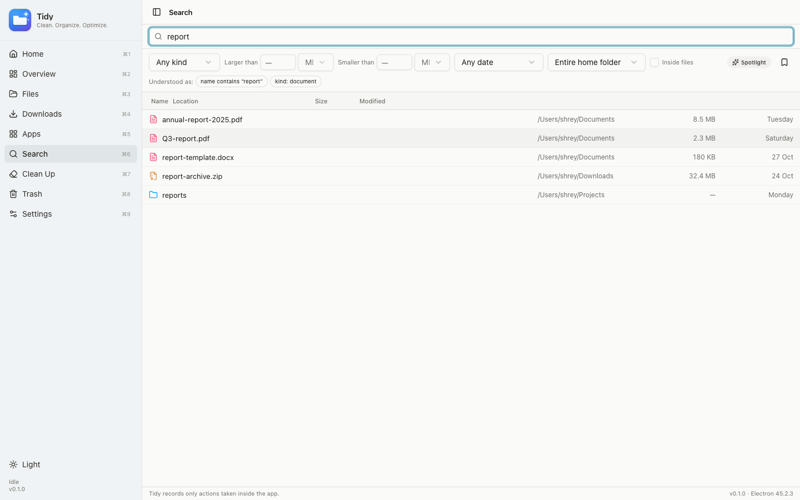
    </td>
    <td width="50%">
      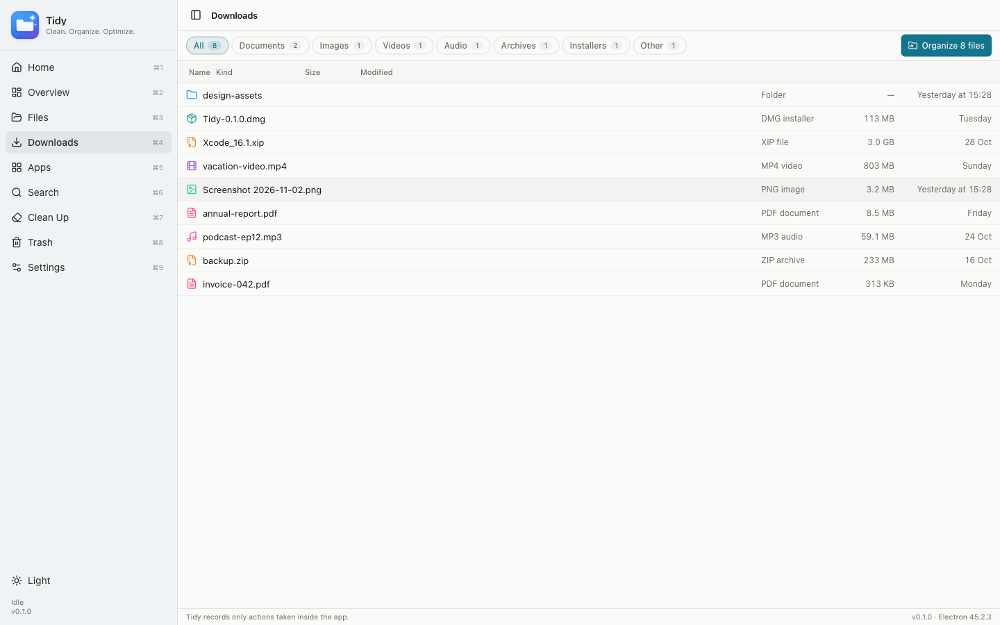
    </td>
  </tr>
  <tr>
    <td width="50%">
      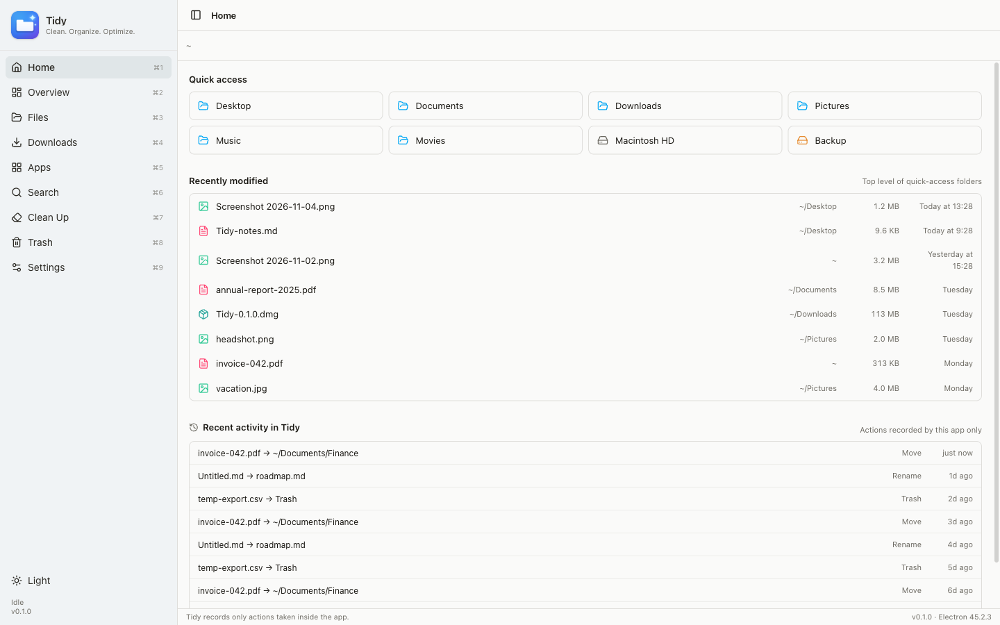
    </td>
    <td width="50%">
      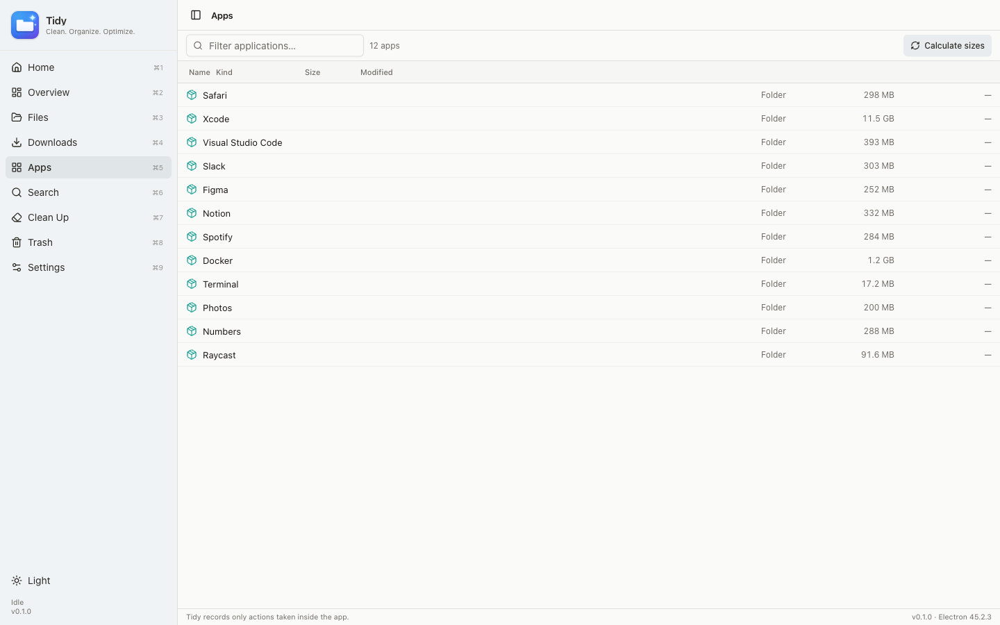
    </td>
  </tr>
  <tr>
    <td width="50%">
      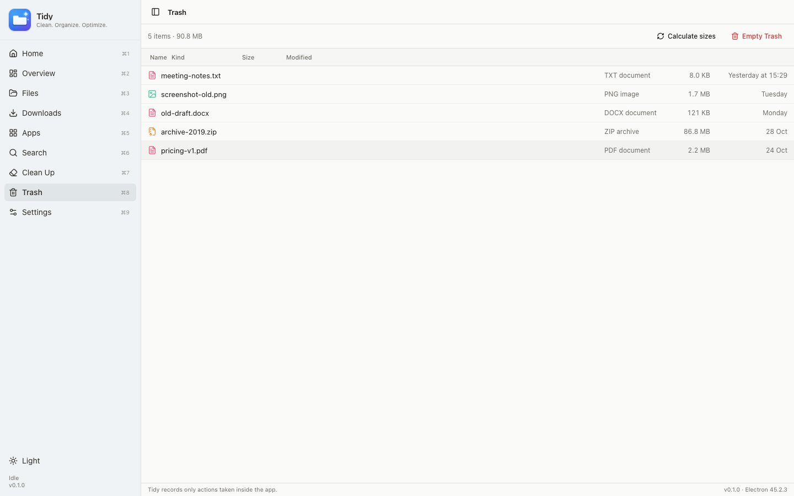
    </td>
    <td width="50%">
      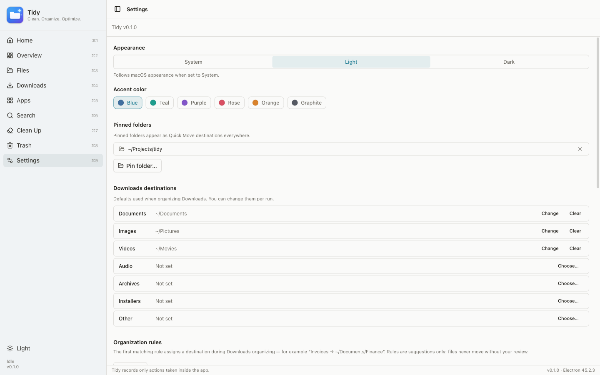
    </td>
  </tr>
</table>

<details>
<summary><strong>Dark mode</strong></summary>
<br />
<p align="center">
  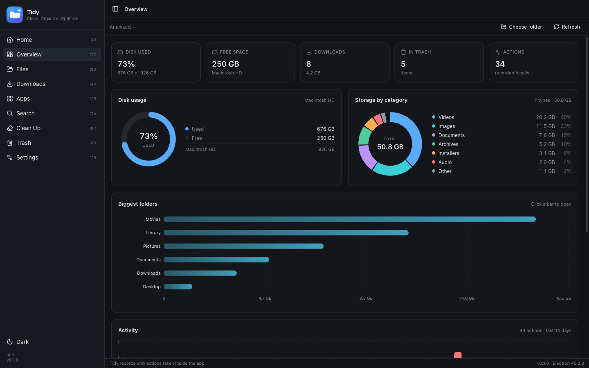
</p>
</details>

## Why Tidy?

macOS ships with Finder, but it was never designed for *cleanup*. Tidy focuses on the jobs people actually open a file manager to do:

- **See where your disk went** — real storage charts, not guesswork.
- **Find the file** — Spotlight-powered search that understands `pdf larger than 20 MB`.
- **Clean up safely** — review every duplicate, large file, and dev artifact before anything moves.
- **Keep your privacy** — no accounts, no telemetry, no network calls.

Everything runs locally. Files go to the macOS Trash, never a black hole.

## Features

### Browse and organize
- **Multi-tab browsing** (⌘T / ⌘W) across any folder, up to **Macintosh HD** and mounted external drives.
- Breadcrumbs, per-tab back/forward, sortable columns, type filters, and ⌘/⇧ multi-select.
- Drag to move, **Quick Move** (⌘⇧M), rename, duplicate, compress/extract ZIP, and **New Folder** with Finder-style inline rename.
- **Get Info** (⌘I) with permissions, dates, and ownership.
- **Quick Look** (Space), **Reveal in Finder**, **Open in Terminal**, and copy path.
- Live updates through folder watching, plus a hidden-file toggle (⌘⇧.).

### Find anything
- Filename search via **macOS Spotlight** (`mdfind`, fixed argv, no shell) with a bounded local-scan fallback.
- Natural queries: `pdf larger than 20 MB`, `type:image`, `ext:zip,dmg`, `size:>10mb`.
- Filters for kind, location, size, and modified date.
- Optional **content search**, saved searches, and recent-query recall.

### Clean up
- **Large files**, **Duplicates** (streamed SHA-256 verified), **Old files**, **Empty folders**, and **Dev artifacts** (`node_modules`, `DerivedData`, `dist`, `build`, `.gradle`, `__pycache__`…).
- A **Storage** tab with volume usage, biggest folders, and size-by-category — all computed with bounded local walks.
- Review-and-approve workflows: nothing is deleted or moved until you confirm.

### Downloads that organize themselves
- Scan Downloads and group everything by type.
- Suggested moves with per-file results and conflict handling.
- **Organization rules** (e.g. “name contains invoice → ~/Documents/Finance”) pre-fill destinations — suggestions only, never automatic.

### Overview dashboard
- Live KPI cards for disk usage, free space, Downloads, Trash, and recorded actions.
- Recharts-powered **disk gauge**, **storage-by-category donut**, **biggest-folders bars**, **14-day activity**, **Downloads-by-type**, and **volumes** comparison.

### Apps and Trash
- Browse `/Applications` and `~/Applications`, calculate bundle sizes, and trash apps with explicit confirmation.
- Review the macOS Trash in-app, restore items, or permanently delete — with Full Disk Access handled gracefully.

### Built for macOS
- Native title bar, system light/dark appearance, and **six accent colors**.
- A polished first-run **permissions walkthrough** that explains *why* each permission is requested.
- Keyboard-first: a command palette (⌘K) and in-app shortcuts for everything.

## Download & install

### Direct download

1. Open **[Releases](https://github.com/shrey/tidy/releases/latest)** and pick the build for your Mac:

   | Your Mac | Download |
   | --- | --- |
   | Apple silicon (M1–M5) | `Tidy-0.1.5-arm64.dmg` |
   | Intel | `Tidy-0.1.5-x64.dmg` |

2. Open the DMG and drag **Tidy** into **Applications**.
3. Launch Tidy and follow the short permissions walkthrough.

> **Install the arm64 build on Apple silicon.** The `x64` build still runs on Apple silicon, but only through Rosetta — it feels noticeably slower. Native `arm64` is the fast one.

> **First launch:** builds are currently unsigned, so macOS may warn that Tidy is from an unidentified developer. Right-click **Tidy** → **Open**, or clear the quarantine flag:
>
> ```bash
> xattr -dr com.apple.quarantine /Applications/Tidy.app
> ```

### Requirements

- macOS 13 (Ventura) or later
- Apple silicon or Intel
- Optional: **Full Disk Access** for Trash insights and protected folders — the app explains where to enable it and never requires it

## Build from source

Requires **Node 20+** and **npm**.

```bash
git clone https://github.com/shrey/tidy.git
cd tidy
npm install
npm run dev      # start the app with HMR (DevTools open automatically)
npm run dist     # regenerate the icon, build, and package .dmg + .zip
```

> npm 12 may block package install scripts on first run (`npm warn install-scripts`). Approve Electron's and esbuild's scripts, then run `npm rebuild electron` if the binary was not downloaded.

### Development scripts

| Command | What it does |
| --- | --- |
| `npm run dev` | Run Tidy with hot reload |
| `npm run build` | Production build into `out/` |
| `npm run dist` | Icon + build + package DMG/ZIP (arm64 + x64) |
| `npm test` | Filesystem fixture tests (rename, move, conflicts, hashing) |
| `npm run typecheck` | Strict TypeScript across main, preload, and renderer |
| `npm run lint` | ESLint |
| `npm run icons` | Regenerate `build/icon.png` and the renderer logo |

## Safety & privacy

- **Read anywhere, change in approved places.** Tidy can browse the disk, but writes are limited to your home folder plus folders you explicitly choose.
- **No silent destruction.** Every move and trash is a user action; collisions are resolved by explicit choice (skip / replace / keep both).
- **Originals survive failures.** Cross-volume moves copy → verify → then remove the source, with per-file results.
- **Process isolation.** All filesystem work runs in the Electron main process; the renderer is sandboxed with `contextIsolation` on, `nodeIntegration` off, and a restrictive CSP. Every IPC payload is validated.
- **Local-only.** No network features, no telemetry, no accounts. Settings and a bounded action history live in `~/Library/Application Support/Tidy/`.
- **Honest permissions.** macOS TCC prompts are surfaced inline with guidance; Full Disk Access is only suggested, never required.

## Keyboard shortcuts

| Keys | Action |
| --- | --- |
| ⌘ 1 | Home |
| ⌘ 2 | Overview |
| ⌘ 3 | Files |
| ⌘ 4 | Downloads |
| ⌘ 5 | Apps |
| ⌘ 6 | Search |
| ⌘ 7 | Clean Up |
| ⌘ 8 | Trash |
| ⌘ 9 | Settings |
| ⌘ K | Command palette |
| ⌘ F | Search |
| ⌘ ⇧ M | Quick Move (Files) |
| ⌘ T / ⌘ W | New / close tab (Files) |
| ⌘ I | Get Info (Files selection) |
| Enter | Open selection |
| Space | Quick Look |
| ⌘ ↑ | Enclosing folder |
| ⌘ A | Select all |
| ⌘ ⌫ | Move selection to Trash |
| ⌘ ⇧ . | Show / hide hidden files |
| Esc | Clear selection / close dialogs |

Shortcuts work inside the app window only; Tidy registers no global shortcuts.

## Tech stack

| Layer | Choice |
| --- | --- |
| Shell | Electron 45 + electron-vite |
| UI | React 19 + TypeScript (strict) |
| Styling | Tailwind CSS v4 + shadcn/ui |
| Charts | Recharts |
| State | Zustand |
| Search | macOS Spotlight (`mdfind`) with a bounded local fallback |
| Packaging | electron-builder |
| Tests | `node:test` fixture suites |

## Project structure

```text
shared/            types + category constants shared by all processes
src/main/          privileged logic: IPC handlers, filesystem services, search, cleanup, watcher
src/main/lib/      small main-process helpers (dev dock icon lookup)
src/preload/       typed contextBridge API — the only renderer-visible surface
src/renderer/src/  React app
  app/             shell, routing, global shortcuts
  features/        home, overview, browser, downloads, apps, search, cleanup, trash, settings, permissions
  components/      shared UI, file table, dialogs, sidebar, toolbar primitives
scripts/           node:test fixture suites + dependency-free icon generator
docs/screenshots/  README screenshots
build/             generated app icon
```

## Roadmap

- [x] Multi-tab file browser with per-tab history
- [x] Spotlight search with natural-language filters
- [x] Clean Up suite + Storage charts
- [x] Overview dashboard
- [x] Trash review and restore
- [x] First-run permissions onboarding
- [ ] Signed and notarized builds
- [ ] Dual-pane / split view
- [ ] More archive formats besides `.zip`
- [ ] Finder-style multi-file clipboard paste

## Known limitations

- Only `.zip` archives are supported for Compress/Extract (via the system `ditto`).
- Content search requires macOS Spotlight; the local fallback is filename-only.
- Storage and cleanup walks are depth- and count-capped, so extremely deep trees may be undercounted.
- Cross-volume moves of *folders* are refused (copies are fine).
- Builds are unsigned and not notarized.

## Contributing

Contributions are welcome — issues, ideas, and pull requests alike.

1. Fork the repo and create a branch: `git checkout -b feat/my-change`
2. Make your change and keep it focused.
3. Run the checks: `npm run typecheck && npm run lint && npm test`
4. Open a pull request describing the problem and the fix.

If you find a security or privacy issue, please open a private advisory instead of a public issue.

Maintainers: see [RELEASING.md](RELEASING.md) for the step-by-step release process.

## Acknowledgements

Tidy stands on the shoulders of [Electron](https://www.electronjs.org/), [React](https://react.dev/), [electron-vite](https://electron-vite.org/), [Tailwind CSS](https://tailwindcss.com/), [shadcn/ui](https://ui.shadcn.com/), [Recharts](https://recharts.org/), [Zustand](https://zustand-demo.pmnd.rs/), and [Lucide](https://lucide.dev/).

The app icon is generated locally by [`scripts/generate-icon.mjs`](scripts/generate-icon.mjs) using a dependency-free PNG encoder.

## License

[MIT](LICENSE) © Shrey